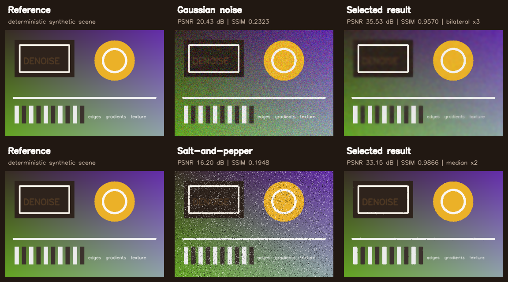
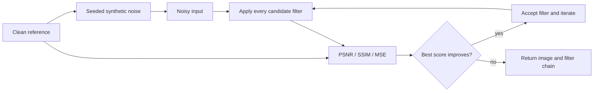

# Search-Based Image Denoising

[](https://www.python.org/)
[](https://opencv.org/)
[](results/demo_metrics.json)
[](LICENSE)

A reproducible computer-vision experiment that turns classical filter selection into a greedy optimization problem. The system evaluates multiple denoisers, accepts only score-improving steps, and can chain filters until the search converges.

This project emphasizes **evaluation design**, **deterministic experimentation**, and **interpretable search**. In benchmark mode every result is measured against a clean ground-truth image; the interactive GUI is kept separate because a noisy image cannot serve as its own correctness target.



## Results at a glance

The committed benchmark uses a deterministic 480 x 320 test scene, seed 7, Gaussian noise with sigma = 25, and 8% salt-and-pepper corruption.

| Noise | Noisy input | Selected chain | Search result | PSNR gain |
| --- | --- | --- | --- | ---: |
| Gaussian | 20.43 dB / 0.2323 SSIM | bilateral x3 | **35.53 dB / 0.9570 SSIM** | **+15.10 dB** |
| Salt-and-pepper | 16.20 dB / 0.1948 SSIM | median x2 | **33.15 dB / 0.9866 SSIM** | **+16.95 dB** |

The filter ordering changes with the corruption model. Bilateral filtering is the strongest single-pass candidate for Gaussian noise, while median filtering dominates impulse noise. The search discovers that switch from the metrics; it receives no noise-specific filter rule.

The figure and every value in this table are generated by [`scripts/generate_demo_assets.py`](scripts/generate_demo_assets.py). Full-precision outputs, single-pass comparisons, seeds, parameters, and library versions are retained in [`results/demo_metrics.json`](results/demo_metrics.json).

## How it works



Each candidate is evaluated with an equal-weight composite score:

```text
score = normalized PSNR + SSIM - normalized MSE
```

PSNR is capped at 100 dB for scoring, MSE is normalized over the 8-bit pixel range, and the weights are configurable. The result remains interpretable: the returned history records every accepted operation and its PSNR, SSIM, MSE, and composite score.

### Search space

The default search contains five noise-reducing operations:

- Gaussian blur
- median blur
- bilateral filtering
- 5 x 5 box filtering
- fast non-local means

Sharpening, high-pass, Laplacian, Sobel, Otsu thresholding, and Canny are implemented separately as `ENHANCEMENT_OPERATIONS`. They are deliberately excluded from the denoising search because they enhance structure or edges rather than suppress noise.

## Reproduce the benchmark

```bash
git clone https://github.com/coderyaz856/Image-denoising---Python.git
cd Image-denoising---Python

python -m venv .venv
# Windows: .venv\Scripts\activate
# Linux/macOS: source .venv/bin/activate
pip install -r requirements.txt

python scripts/generate_demo_assets.py
python -m unittest discover -s tests -v
```

The generator overwrites only the committed evidence artifacts:

- `assets/benchmark_overview.png`
- `results/demo_metrics.json`

## Run on an image

Add seeded Gaussian noise and benchmark the search against a clean image:

```bash
python image_denoising.py \
  --clean path/to/image.png \
  --noise gaussian \
  --sigma 25 \
  --seed 7 \
  --iterations 5 \
  --output denoised.png
```

For salt-and-pepper noise:

```bash
python image_denoising.py \
  --clean path/to/image.png \
  --noise salt_pepper \
  --amount 0.08 \
  --seed 7 \
  --output denoised.png
```

Launch the Tk interface with:

```bash
python image_denoising.py --gui
```

The GUI is useful for visual exploration and reports the selected filter chain. Because it has no clean reference, its score measures similarity to the opened image. Use benchmark mode for defensible quality measurements.

## Engineering details

- **Ground-truth evaluation:** benchmark metrics compare every candidate with the clean source, avoiding the common mistake of rewarding filters for resembling the noisy input.
- **Deterministic noise:** both noise models accept an explicit NumPy generator seed.
- **Safe metric arithmetic:** images are converted from `uint8` before subtraction, preventing wraparound from corrupting MSE.
- **Version-compatible SSIM:** the implementation supports both `channel_axis` and the older `multichannel` scikit-image API.
- **Bounded search:** a candidate must beat the score carried into the iteration; otherwise the algorithm stops immediately.
- **Inspectable evidence:** the benchmark stores configurations, exact metrics, selected chains, single-pass baselines, and environment versions as JSON.

## Repository map

```text
image_denoising.py              filters, metrics, search, CLI, and Tk GUI
scripts/generate_demo_assets.py deterministic evidence and figure generator
tests/test_image_denoising.py   metric, noise-model, and search regressions
assets/benchmark_overview.png   generated visual comparison
results/demo_metrics.json       generated full-precision benchmark record
requirements.txt                runtime dependencies
```

Key Python entry points are `optimize_image_denoising()` for the search, `calculate_quality_metrics()` for PSNR/SSIM/MSE, and `run_benchmark()` for clean-versus-corrupted evaluation.

## Scope and limitations

This is a compact study of classical denoisers, not a claim of state-of-the-art restoration. It does not train a model or compare against learned methods such as DnCNN. The committed results use one synthetic scene and idealized independent noise; real camera noise is signal-dependent and varies across sensors. The composite weights are exposed rather than tuned, so changing the objective can change the selected chain.

Those boundaries are intentional: the repository demonstrates how to build a small image-processing experiment whose decisions, measurements, and artifacts can all be inspected and reproduced.
